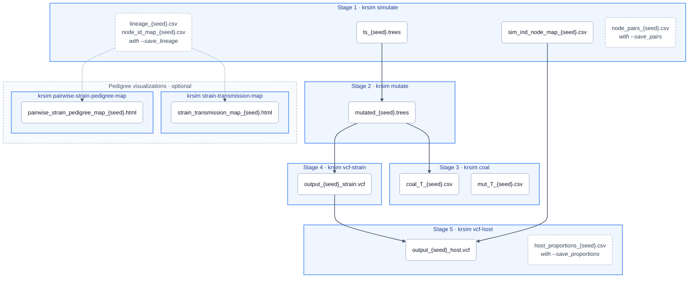

# krsim — Malaria Transmission Simulator

A forward simulator that brings together malaria modelling and population genetics to model parasite transmission. Whole-genome information is tracked through every recombination event as an ancestral recombination graph, stored efficiently with [tskit](https://tskit.dev). From the recorded genealogy (a tree sequence), krsim overlays mutations and outputs coalescence times across the genome and VCF files at the strain level and at the (observed) host level.

## Installation

You need [conda](https://conda-forge.org/download/) (Miniforge, Miniconda or Anaconda). Download the environment file and create the environment:

```bash
curl -O https://raw.githubusercontent.com/mrc-ide/KR_simulator/main/environment-user.yml
conda env create -f environment-user.yml
conda activate krsim
```

Check it worked with `krsim --help`, which lists every command. 

To update krsim later, run `pip install --upgrade --force-reinstall --no-deps git+https://github.com/mrc-ide/KR_simulator.git` with the environment active.

## Tutorial

The tutorial is a Jupyter notebook, [tutorial.ipynb](tutorial/tutorial.ipynb), that goes through each stage of the pipeline and visualises the outputs. To run it, activate the `krsim` environment, then run the commands below. 

```bash
curl -O https://raw.githubusercontent.com/mrc-ide/KR_simulator/main/tutorial/tutorial.ipynb
jupyter notebook tutorial.ipynb
```

It writes its files to `output/` next to the notebook.

## Quick start

With the `krsim` environment active, run the pipeline on a small example. Results go to `krsim_quickstart_output/` in the current folder (krsim creates it):

```bash
OUT=krsim_quickstart_output

krsim simulate   --Nh 3 --T 10 --K 2 --chi 0.18 --C 1 --random_seed 123 --output_dir $OUT
krsim mutate     --ts $OUT/ts_123.trees --random_seed 123 --output_dir $OUT
krsim coal       --ts $OUT/mutated_123.trees --random_seed 123 --output_dir $OUT
krsim vcf-strain --ts $OUT/mutated_123.trees --random_seed 123 --output_dir $OUT
krsim vcf-host   --strain_vcf $OUT/output_123_strain.vcf --ind_node_map_csv $OUT/sim_ind_node_map_123.csv \
                 --depth 10 --random_seed 123 --output_dir $OUT
```

`krsim <command> --help` lists every option for a command.

## Pipeline



Each blue box is a `krsim` command and the files it writes; dashed files need the flag shown. Arrows show which files each command reads. Every command also records what it did in `KR_sim_{seed}.log` in its `--output_dir`.

## Development

To work on the code itself, see [DEVELOPMENT.md](DEVELOPMENT.md).
