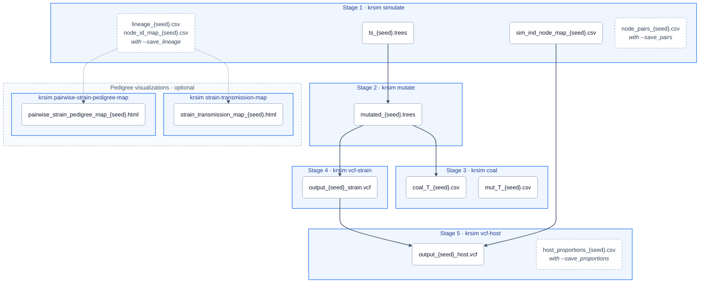

# krsim — Malaria Transmission Simulator

A forward simulator that brings together malaria modelling and population genetics to model parasite transmission. Whole-genome information is tracked through every recombination event as an ancestral recombination graph, stored efficiently with [tskit](https://tskit.dev). From the recorded genealogy (a tree sequence), krsim overlays mutations and outputs coalescence times across the genome and VCF files at the strain level and at the (observed) host level.

## Installation

Requires Python 3.9 or newer.

```bash
git clone https://github.com/mrc-ide/KR_simulator.git
cd KR_simulator
python3 -m venv .venv
source .venv/bin/activate          # Windows: .venv\Scripts\activate
python -m pip install --upgrade pip
pip install -e .
```

Upgrading pip matters: older pip versions (such as the 21.x that ships with macOS's built-in Python) fail with `Directory cannot be installed in editable mode`.

Or with conda: `conda env create -f environment.yml && conda activate kr_malaria`.

To reproduce results with the exact package versions used in development, run `pip install -r requirements.txt` before `pip install -e .`.

### Check the install

Still in the `KR_simulator` folder with the environment active, run:

```bash
krsim --help
bash tests/test_sim_mut.sh
```

The test runs every command on a small simulation and compares the results in `tests/output/` with the saved results in `tests/baseline/` (decimal numbers only need to match to 12 significant digits, since the last digit can vary between machines). If everything is installed correctly, it ends with `All 13 check(s) passed.` Answer `N` (or press Enter) at the final prompt, which asks whether to replace the baseline.

## Quick start

From the `KR_simulator` folder, run the pipeline on a small example. Results go to `krsim_output/`, a folder next to the repo (krsim creates it), so they stay out of git:

```bash
OUT=../krsim_output

krsim simulate   --Nh 3 --T 10 --K 2 --chi 0.18 --C 1 --random_seed 123 --output_dir $OUT
krsim mutate     --ts $OUT/ts_123.trees --random_seed 123 --output_dir $OUT
krsim coal       --ts $OUT/mutated_123.trees --random_seed 123 --output_dir $OUT
krsim vcf-strain --ts $OUT/mutated_123.trees --random_seed 123 --output_dir $OUT
krsim vcf-host   --strain_vcf $OUT/output_123_strain.vcf --ind_node_map_csv $OUT/sim_ind_node_map_123.csv \
                 --depth 10 --random_seed 123 --output_dir $OUT
```

`krsim <command> --help` lists every option for a command. The [tutorial](tutorial/tutorial.ipynb) runs each command and shows what it writes.

## Pipeline



Each blue box is a `krsim` command and the files it writes; dashed files need the flag shown. Arrows show which files each command reads. Every command also records what it did in `KR_sim_{seed}.log` in its `--output_dir`.

## Output files

| File | Command | Contents |
|---|---|---|
| `ts_{seed}.trees` | simulate | Tree sequence (no mutations) |
| `sim_ind_node_map_{seed}.csv` | simulate | Which strains each host carries |
| `lineage_{seed}.csv`, `node_id_map_{seed}.csv` | simulate `--save_lineage` | True generation-by-generation pedigree |
| `node_pairs_{seed}.csv` | simulate `--save_pairs` | Strain pairs from the same meiosis |
| `mutated_{seed}.trees` | mutate | Tree sequence with mutations |
| `coal_T_{seed}.csv` | coal | Pairwise coalescence times per tree interval |
| `mut_T_{seed}.csv` | coal | Position and age of every mutation |
| `output_{seed}_strain.vcf` | vcf-strain | Per-strain genotypes (0/1) |
| `output_{seed}_host.vcf` | vcf-host | Per-host genotypes (0/0, 0/1, 1/1) |
| `host_proportions_{seed}.csv` | vcf-host `--save_proportions` | Strain proportions and reads per host |
| `strain_transmission_map_{seed}.html` | strain-transmission-map | Interactive pedigree of the whole run |
| `pairwise_strain_pedigree_map_{seed}.html` | pairwise-strain-pedigree-map | Traces two strains back to shared ancestors |
| `KR_sim_{seed}.log` | all | What each command ran and wrote |
