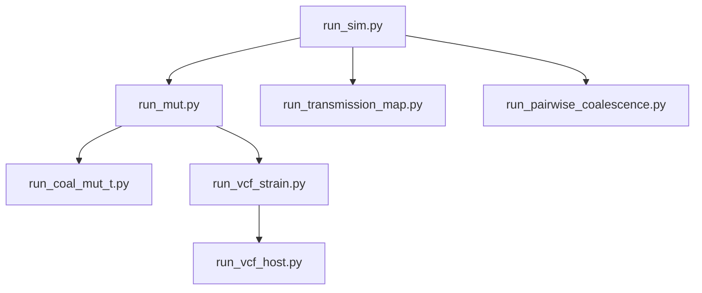

# KR_SIM — Malaria Transmission Simulator

A forward simulation framework for *Plasmodium falciparum* recombination and transmission dynamics. Produces tree sequences with full genealogical history, downstream VCF outputs at both the parasite-strain and human-host level, coalescence/mutation time tables, pedigree-based relatedness, and an interactive transmission-map visualization.

---

## Installation

### Clone the repository

```bash
git clone https://github.com/your-username/KR_SIM.git
cd KR_SIM
```

### Option 1 — uv (fastest)
```bash
uv venv
source .venv/bin/activate
uv pip install -r requirements.txt
```

### Option 2 — conda
```bash
conda env create -f environment.yml
conda activate kr_malaria
```

### Option 3 — pip
```bash
python -m venv .venv
source .venv/bin/activate   # Mac / Linux
.venv\Scripts\activate      # Windows
pip install -r requirements.txt
```

---

## Pipeline

The core simulation is split into five independent stages, plus two pedigree-based tools, `run_transmission_map.py` and `run_pairwise_coalescence.py`, which both branch directly off Stage 1 and only need its `--save_lineage` output. Each stage reads the previous stage's output from disk, so you can stop, inspect, and resume at any point.



`run_transmission_map.py` and `run_pairwise_coalescence.py` both hang directly off `run_sim.py` and don't depend on anything else.

Coalescence-time relatedness and the hmmIBD benchmark are optional, separate tools — see [Extras](#extras) below.

### Stage 1 — Simulate genealogy

```bash
python run_sim.py \
    --Nh 100 --T 50 --K 2 --chi 0.18 --C 1 \
    --recombination_rate 7.4e-7 \
    --random_seed 42 \
    --out_dir results/ \
    --save_ts --save_ID --save_pairs
```

| Flag | Description |
|---|---|
| `--Nh` | Number of human hosts |
| `--T` | Transmission generations |
| `--K` | Parasite strains per transmission event |
| `--chi` | Superinfection probability (0–1) |
| `--C` | Oocysts per mosquito |
| `--recombination_rate` | Per-bp recombination rate |
| `--random_seed` | Seed for reproducibility |
| `--out_dir` | Output directory |
| `--save_ts` | Save tree sequence to `ts_{seed}.trees` |
| `--save_ID` | Save individual–node mapping to `sim_ind_node_map_{seed}.csv`, including each node's `time` (generations before present; `0` = most recent/current generation) |
| `--save_pairs` | Save recombinant node pairs to `node_pairs_{seed}.csv` |
| `--save_lineage` | Save per-generation child→parent strain lineage to `lineage_{seed}.csv`, plus a `node_id_map_{seed}.csv` pre/post-`simplify()` ID mapping — turn this on if you want true generation-by-generation parentage (for the transmission map, pedigree relatedness, or your own analysis), since the final tree sequence alone can skip generations |

### Transmission map — visualize the pedigree

```bash
python run_transmission_map.py \
    --random_seed 42 \
    --output_dir results/
```

Needs `--save_lineage` from Stage 1. Renders an interactive, self-contained `transmission_map_{seed}.html` — a generation-by-generation pedigree diagram (founders at top, current samples at bottom, one lane per host) built from the pre-simplify `lineage_{seed}.csv`, so it shows the true parentage that `simplify()` compresses away. Each strain is labeled with its pre-simplify ID (with its post-simplify ID as a small corner badge, where one exists); clicking a strain traces and highlights its full ancestry and descendants. Open the file directly in a browser — no server or dependencies needed. Intended for small debug runs (a handful of hosts, a few dozen generations); it warns in-page and degrades gracefully past that, but isn't meant for production-scale runs (`--Nh 100`, etc.). Runs right after Stage 1 in `examples/run_example.py`, before mutations/VCFs, so you can inspect the raw transmission history immediately.

### Pairwise coalescence — trace two strains back to their shared ancestor

```bash
python run_pairwise_coalescence.py \
    --random_seed 42 \
    --output_dir results/
```

Also only needs `--save_lineage` from Stage 1 — same inputs as the transmission map. Renders `pairwise_coalescence_{seed}.html`: pick any two current-generation strains (dropdowns, or click two strains in the diagram) and it traces each one's full ancestry back through the pedigree, drawing strain 1's lineage in one color and strain 2's in another. Where the two colors overlap is a shared ancestor; the *most recent* shared ancestor(s) are highlighted as the coalescence point(s), with the number of generations back reported for each strain. Because a strain can have up to two immediate parents (one per gamete in the oocyst that produced it), there can be more than one coalescence point — the two ancestries can independently merge via more than one path.

This is a **pedigree** trace, not a genomic one: a shared ancestor here means the two strains' host lineages shared a parasite at that generation, not that any specific genomic region was actually inherited from it — recombination can replace a segment with DNA from the other parent at every step. Same small-debug-run scope as the transmission map.

### Stage 2 — Add mutations

```bash
python run_mut.py \
    --ts results/ts_42.trees \
    --mutation_rate 1e-6 \
    --random_seed 42 \
    --output_dir results/
```

Outputs `mutated_{seed}.trees`. All stages from here onwards use the mutated tree sequence.

### Stage 3 — Coalescence & mutation times

```bash
python run_coal_mut_t.py \
    --ts results/mutated_42.trees \
    --random_seed 42 \
    --output_dir results/
```

Outputs `coal_T_{seed}.csv` (pairwise MRCA times per tree interval) and `mut_T_{seed}.csv` (position and age of every mutation). Both tables include a `chromosome` column (1-indexed, from `sim/params.py`'s `COMP_BREAKPOINTS`), with `position`/`left`/`right` given as chromosome-local coordinates rather than genome-wide ones. `coal_T` only contains rows where the sample pair has a common ancestor in that tree interval — pairs with no shared ancestry anywhere in the ARG are simply absent from the table.

### Stage 4 — Strain-level VCF

```bash
python run_vcf_strain.py \
    --ts results/mutated_42.trees \
    --random_seed 42 \
    --output_dir results/
```

Outputs `output_{seed}_strain.vcf` — one sample column per parasite strain (node), genotypes `0`/`1`.

### Stage 5 — Host-level VCF

```bash
python run_vcf_host.py \
    --strain_vcf results/output_42_strain.vcf \
    --random_seed 42 \
    --depth 10 \
    --output_dir results/ \
    --save_proportions
```

Aggregates the strain VCF to individual (host) level using a **Dirichlet-Multinomial** model:
1. Within-host strain proportions sampled once per host from Dirichlet(α=1 per strain)
2. `--depth` sequencing reads drawn once per host via Multinomial from those proportions
3. At each variant site, genotype called as `0/0` (all reads carry ref), `1/1` (all reads carry alt), or `0/1` (mixed) from the fixed per-strain read counts

Outputs `output_{seed}_host.vcf`. With `--save_proportions`, also writes `host_proportions_{seed}.csv`.

---

## Extras

Optional tools, not run by `run_example.py` — live in `extras/` and are run manually when you specifically need them.

### Coalescence-time relatedness

```bash
python extras/relate_t_strain.py \
    --random_seed 42 \
    --time_boundary 2 \
    --output_dir results/

python extras/relate_t_host.py \
    --random_seed 42 \
    --output_dir results/
```

`relate_t_strain.py`: for each strain pair in `coal_T_{seed}.csv`, sums the length of tree intervals where `coal_time <= --time_boundary` and divides by `GENOME_LENGTH` to give the fraction of the genome that is IBD below that time threshold. Pairs with no recorded coalescence anywhere in the ARG are not written as a row (rather than a `0` row). Outputs `relate_strain_{seed}.csv` (`sample_1`, `sample_2`, `frac_IBD`).

`relate_t_host.py`: for each currently-infected host (from `sim_ind_node_map_{seed}.csv`, restricted to `time == 0`, i.e. the most recent generation), takes every pairwise combination of that host's strain nodes and averages their `frac_IBD` from `relate_strain_{seed}.csv`. Pairs missing from that table (no recorded coalescence) are treated as `frac_IBD = 0`. Hosts with fewer than two strains get an empty average. Outputs `relate_host_{seed}.csv` (`host`, `avg_frac_IBD`).

### hmmIBD benchmark

```bash
python extras/benchmark_hmmibd.py \
    --strain_vcf  results/output_42_strain.vcf \
    --relate_strain results/relate_strain_42.csv \
    --random_seed 42 \
    --output_dir  results/
```

Converts the strain VCF to hmmIBD's hap + freq input format, runs hmmIBD, then compares its inferred pairwise IBD fractions against the simulation ground truth from `relate_strain_{seed}.csv`. Outputs a comparison CSV and a scatter plot (true vs inferred).

Requires hmmIBD to be installed:
```bash
git clone https://github.com/glipsnort/hmmIBD.git
cd hmmIBD && gcc -o hmmibd hmmIBD.c -lm
# add to PATH, or pass --hmmibd /path/to/hmmibd
```

---

## Output files

| File | Stage | Description |
|---|---|---|
| `ts_{seed}.trees` | 1 | Tree sequence (no mutations) |
| `sim_ind_node_map_{seed}.csv` | 1 | Host → strain node mapping, with each node's `time` (generations before present) |
| `node_pairs_{seed}.csv` | 1 | Recombinant node pairs from same meiosis |
| `lineage_{seed}.csv` | 1 | Per-generation child→parent strain lineage, pre-simplify node IDs (`--save_lineage`) |
| `node_id_map_{seed}.csv` | 1 | Pre-simplify → post-simplify node ID mapping (`--save_lineage`) |
| `mutated_{seed}.trees` | 2 | Tree sequence with mutations |
| `coal_T_{seed}.csv` | 3 | Pairwise coalescence times per tree interval (chromosome-local coordinates) |
| `mut_T_{seed}.csv` | 3 | Mutation chromosome, position, and age |
| `output_{seed}_strain.vcf` | 4 | Per-strain genotypes (0/1) |
| `output_{seed}_host.vcf` | 5 | Per-host genotypes (0/0, 0/1, 1/1) |
| `host_proportions_{seed}.csv` | 5 | Dirichlet proportions and read counts per host |
| `transmission_map_{seed}.html` | additional | Interactive transmission-map visualization |
| `pairwise_coalescence_{seed}.html` | additional | Interactive pedigree coalescence trace for any two strains |
| `relate_strain_{seed}.csv` | extras | Pairwise strain IBD fraction (`extras/relate_t_strain.py`) |
| `relate_host_{seed}.csv` | extras | Average pairwise IBD fraction per host, most recent generation only (`extras/relate_t_host.py`) |
| `hmmibd_hap_{seed}.txt` | extras | hmmIBD hap input file (genotypes) |
| `hmmibd_freq_{seed}.txt` | extras | hmmIBD freq input file (allele frequencies) |
| `hmmibd_{seed}.hmm_fract.txt` | extras | hmmIBD raw pairwise IBD output |
| `ibd_benchmark_{seed}.csv` | extras | True vs inferred IBD for all strain pairs |
| `ibd_benchmark_{seed}.png` | extras | Scatter plot — true vs inferred IBD |
| `KR_sim_{seed}.log` | 1–2 | Accumulated log — only `run_sim.py` and `run_mut.py` currently write to it |

---

## Project structure

```
KR_SIM/
├── run_sim.py            # Stage 1: simulate genealogy
├── run_mut.py            # Stage 2: add mutations
├── run_coal_mut_t.py     # Stage 3: coalescence & mutation times
├── run_vcf_strain.py     # Stage 4: strain-level VCF
├── run_vcf_host.py           # Stage 5: host-level VCF
├── run_transmission_map.py   # Interactive transmission-map HTML (needs only Stage 1's --save_lineage)
├── run_pairwise_coalescence.py # Interactive pairwise pedigree coalescence HTML (needs only Stage 1's --save_lineage)
│
├── extras/               # Optional tools, not run by run_example.py — run manually
│   ├── relate_t_strain.py    #   Coalescence-time IBD fraction (needs coal_T from Stage 3)
│   ├── relate_t_host.py      #   Host-level average of relate_t_strain.py's output
│   └── benchmark_hmmibd.py   #   hmmIBD vs simulation ground truth
│
├── sim/                  # Core simulation engine
│   ├── params.py         #   SimParams dataclass + genome constants
│   ├── simulator.py      #   KRSimulator class
│   ├── recombination.py  #   Compulsory and Poisson recombination
│   └── transmission.py   #   Human-mosquito-human transmission
│
├── output/               # Shared I/O helpers (used by all stage scripts)
│   ├── sim_ind_node_id.py
│   ├── node_pairs.py
│   ├── lineage.py        #   Builds lineage_{seed}.csv (pre-simplify)
│   ├── node_id_map.py    #   Builds node_id_map_{seed}.csv
│   ├── transmission_map.py #   Renders transmission_map_{seed}.html
│   ├── pairwise_coalescence.py #   Renders pairwise_coalescence_{seed}.html
│   ├── vcf_strain_single.py
│   └── vcf_host_single.py
│
├── examples/             # Worked example with seed 123
│   ├── example.ipynb     #   Notebook walkthrough of all outputs
│   ├── run_example.py    #   Script to run the full example pipeline
│   └── README.md         #   Output file descriptions
│
├── scripts/              # Testing and regression tools
│   ├── test_sim_mut.sh   #   Run full pipeline + regression check
│   ├── compare_outputs.py#   Diff outputs against expected/
│   └── expected/         #   Committed reference outputs (blessed baseline)
│
├── config.yml            # Example parameter file
├── environment.yml       # Conda environment
└── requirements.txt      # pip dependencies
```

---

## Quick start (worked example)

```bash
python examples/run_example.py
```

Then open `examples/example.ipynb` to explore all outputs interactively.

---

## Running tests

```bash
bash scripts/test_sim_mut.sh
```

Runs the full pipeline with seed 123, prints a summary of every output file, then diffs the results against `scripts/expected/`. Answer `y` at the prompt to promote the current outputs as the new baseline.

---

## Requirements

- Python ≥ 3.9
- tskit
- msprime
- numpy
- pandas
- matplotlib
- pyyaml
