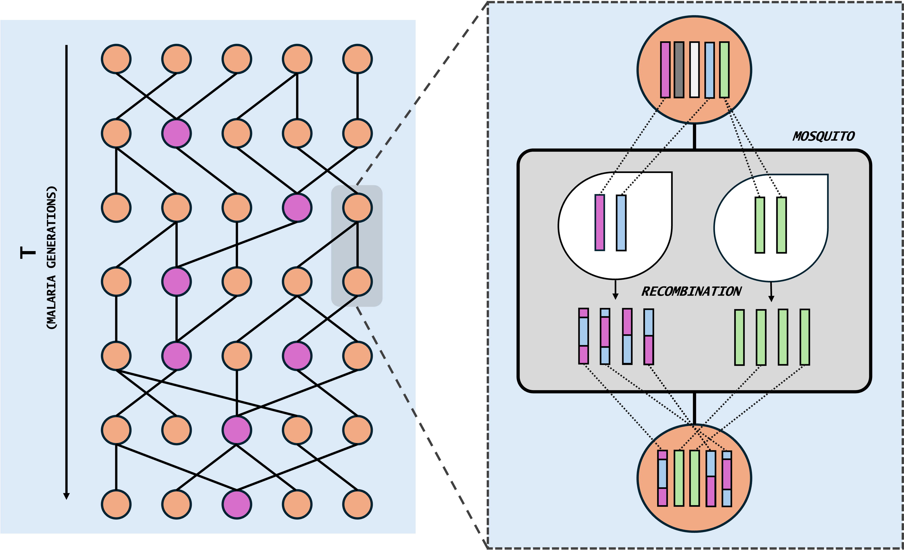
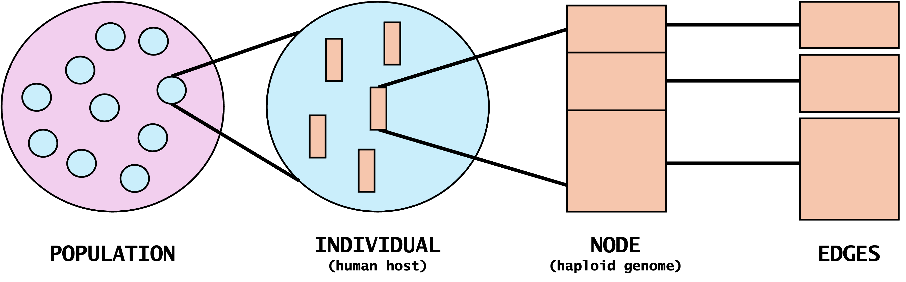

## Why krsim

krsim models the transmission of malaria parasites between human hosts through mosquito vectors. It builds on the Wright–Fisher model, a foundational model of population genetics, and adds a few key epidemiological factors: superinfection, the number of parasites passed on in each bite, and the number of oocysts in each mosquito.

This approach was first taken by [Kwiatkowski (2024)](https://doi.org/10.12688/wellcomeopenres.19092.1), following a single genetic locus. krsim extends it to the whole genome: using [tskit](https://tskit.dev), it records every recombination event, so the full ancestry of every parasite genome is kept, and it stays very fast to run.

krsim can be used to:

- **simulate transmission** under known parameter values
- **understand relatedness** between parasite strains, within and between hosts
- **benchmark whole-genome tools**, such as relatedness and IBD methods, against a known truth

It is designed as a foundational model, with many possible avenues for extension.

## The transmission model

krsim follows a population of `Nh` human hosts through `T` discrete, non-overlapping generations. Each host carries one or more parasite strains, and in every generation each host is infected afresh by parasites drawn from the hosts of the previous generation, passed on by a mosquito.

{width="80%" fig-align="center" fig-alt="Left: hosts (circles) across T malaria generations, linked by transmission. Right: one transmission in detail. Parasites from the parent host pair up in the mosquito, recombine, and the resulting recombinant parasites are passed on to the new host."}

**Founders.** The simulation starts `T` generations before the present. Each founder host carries `K` strains, or `2K` if it is superinfected, which happens with probability `chi`.

**Each generation**, every host in the new generation is infected in one of two ways:

- **Single infection** (probability `1 − chi`): one parent host is chosen at random, and one mosquito carries `K` parasites from it.
- **Superinfection** (probability `chi`): two different parent hosts are chosen, and each passes on `K` parasites through its own mosquito, giving the host `2K` strains.

**Inside the mosquito**, each of its `C` oocysts is formed from two parasites drawn from the parent host (with replacement, so the same strain can pair with itself). Meiosis in each oocyst produces four recombinant products, and the `K` parasites passed on are drawn from all `4C` products.

| Parameter | Flag | Meaning |
|---|---|---|
| $N_h$ | `--Nh` | Number of human hosts |
| $T$ | `--T` | Number of generations simulated |
| $K$ | `--K` | Parasites passed on per mosquito bite |
| $\chi$ | `--chi` | Probability that a host is superinfected |
| $C$ | `--C` | Oocysts per mosquito |

The model set-up and the choice of these epidemiological parameters follow [Kwiatkowski (2024)](https://doi.org/10.12688/wellcomeopenres.19092.1), where they add just enough malaria transmission dynamics to a Wright–Fisher population. krsim extends this with mosquito dynamics: oocysts, meiosis, and the sampling of the parasites passed on.

Suitable parameter values vary between transmission settings, so choose them to match the setting you want to simulate.

## Recombination

Recombination happens in the mosquito, between the two parasites that form each oocyst. The genome is the *P. falciparum* 3D7 reference: 14 chromosomes, 23.57 Mb in total. Each recombination event between two parental genomes combines two kinds of breakpoint:

- **Independent assortment:** at each chromosome boundary, the products switch parent with probability 0.5.
- **Crossovers:** a Poisson number of breakpoints with mean `recombination_rate × genome length`, placed uniformly along the genome. The default rate is `7.4e-7` per base pair, following [Kwiatkowski (2024)](https://doi.org/10.12688/wellcomeopenres.19092.1).

Two such events per oocyst give its four products.

## Recording ancestry

Every parasite genome is recorded as a node in a [tskit](https://tskit.dev) tree sequence, and every stretch of genome inherited from a parent is recorded as an edge. Together these form an ancestral recombination graph: for any position on the genome, it gives the full genealogy of the current strains.

{width="80%" fig-align="center" fig-alt="How krsim records a simulation in tskit: the population contains individuals (human hosts), each individual carries nodes (haploid parasite genomes), and each node is linked to its parent genomes by edges covering stretches of the genome."}

At the end of the run the tree sequence is simplified to the strains in the current generation, keeping only the ancestry they actually inherited. This is what `ts_{seed}.trees` contains. The `--save_lineage` option keeps the full generation-by-generation pedigree as well, which the [pedigree maps](quickstart.qmd#visualise-transmission) use.

## From genealogy to data

- **Mutations** are added on top of the genealogy with [msprime](https://tskit.dev/msprime), at rate `--mutation_rate` (default `1e-6` per base pair, following [Kwiatkowski (2024)](https://doi.org/10.12688/wellcomeopenres.19092.1)).
- **Coalescence times** are read directly from the genealogy: for every pair of strains and every stretch of genome, when their ancestry last met.
- **Strain VCF**: one haploid genotype per strain, as if each strain were sequenced on its own.
- **Host VCF**: mimics sequencing a mixed infection from a blood sample. Each host's strain proportions are drawn from a Dirichlet distribution, `--depth` reads are shared between its strains, and a site is called `0/1` when the reads carry both alleles.

The VCFs have the same form as real sequencing data, while krsim also knows the true ancestry behind them. This makes them a way to benchmark whole-genome methods against a known truth: for example, comparing the IBD that [hmmIBD](https://github.com/glipsnort/hmmIBD) infers from the strain VCF with the true relatedness from `krsim relate-strain`.

## References

- Kwiatkowski D. (2024). Modelling transmission dynamics and genomic diversity in a recombining parasite population. *Wellcome Open Research* 9:215. <https://doi.org/10.12688/wellcomeopenres.19092.1>

## Citing krsim

A paper describing krsim is in preparation. Until then, please cite the [GitHub repository](https://github.com/mrc-ide/KR_simulator).
