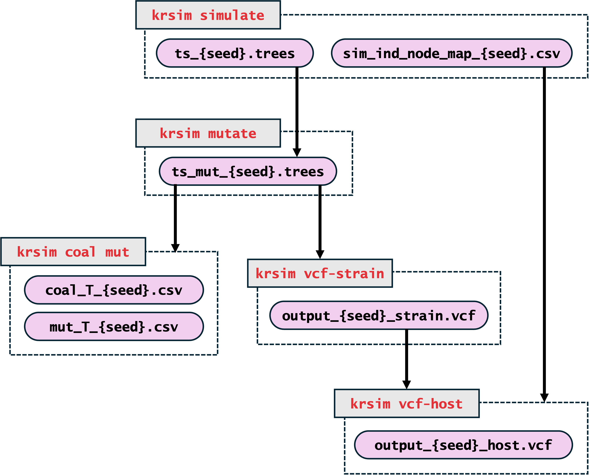

A forward simulator that brings together malaria modelling and population genetics to model parasite transmission. Whole-genome information is tracked through every recombination event as an ancestral recombination graph, stored efficiently with [tskit](https://tskit.dev). From the recorded genealogy (a tree sequence), krsim overlays mutations and outputs coalescence times across the genome and VCF files at the strain level and at the (observed) host level.

::: {.callout-tip}
## Get started
[Install krsim](installation.qmd), run the [quick start](quickstart.qmd), then work through the [tutorial](tutorial.ipynb).
:::

## Pipeline

krsim runs as a series of commands. Each one reads the files written by an earlier stage and writes new ones.

{width="75%" fig-align="center" fig-alt="The krsim pipeline: simulate writes the tree sequence and host–strain map; mutate adds mutations; coal-mut writes coalescence and mutation times; vcf-strain writes the strain VCF; vcf-host combines it with the host–strain map into the host VCF."}

Each grey box is a `krsim` command, and the files inside its dashed outline are the ones it writes. Arrows show which files each command reads. Every command also records what it did in `KR_sim_{seed}.log` in its `--output_dir`.

See the [command-line reference](commands.qmd) for every option and [Output files](outputs.qmd) for what each file contains.
