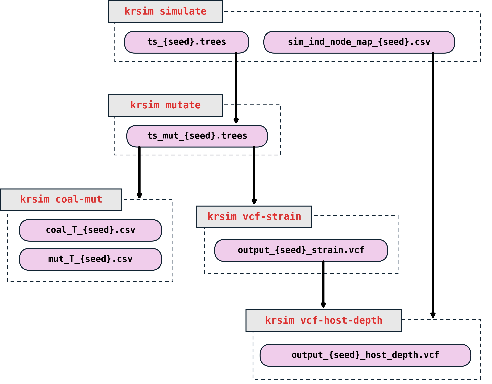

krsim simulates the whole genomes of *Plasmodium falciparum* strains transmitted through a population of human hosts.

From one simulation you can get:

- tree sequences
- coalescence times
- strain-level VCF
- host-level VCF with realistic read depth (krsim's depth model, or your own depth files)

See the [background](background.qmd) for how the model works.

::: {.callout-tip}
## Get started
[Install krsim](installation.qmd), then start with the [quick start](quickstart.qmd).
:::

## Pipeline

krsim runs as a series of commands. Each one reads the files written by an earlier stage and writes new ones.

{width="75%" fig-align="center" fig-alt="The krsim pipeline: simulate writes the tree sequence and host–strain map; mutate adds mutations; coal-mut writes coalescence and mutation times; vcf-strain writes the strain VCF; vcf-host-depth combines it with the host–strain map into the host VCF, with realistic read depth."}

Each grey box is a `krsim` command, and the files inside its dashed outline are the ones it writes. Arrows show which files each command reads. Every command also records what it did in `KR_sim_{seed}.log` in its `--output_dir`.

See the [command-line reference](commands.qmd) for every option and [Output files](outputs.qmd) for what each file contains.
