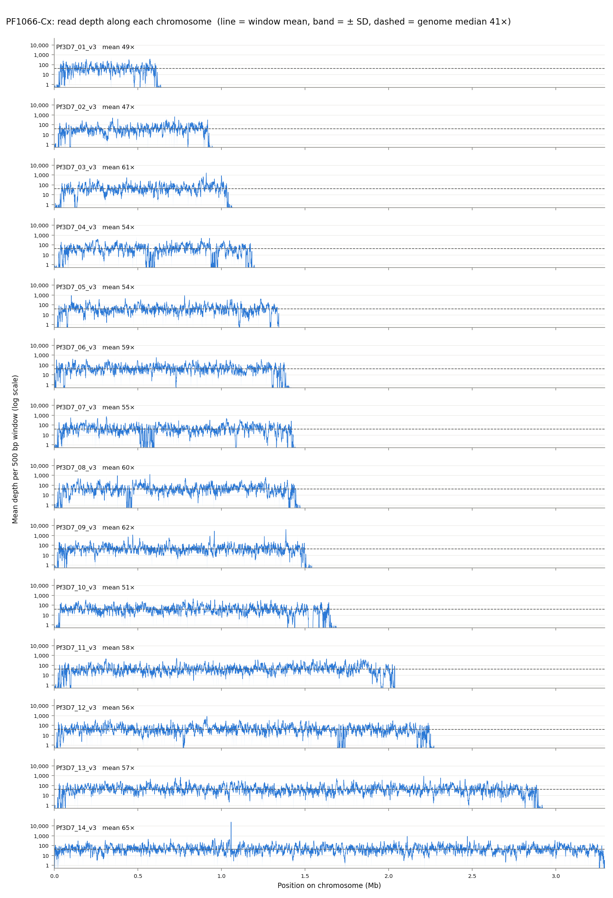
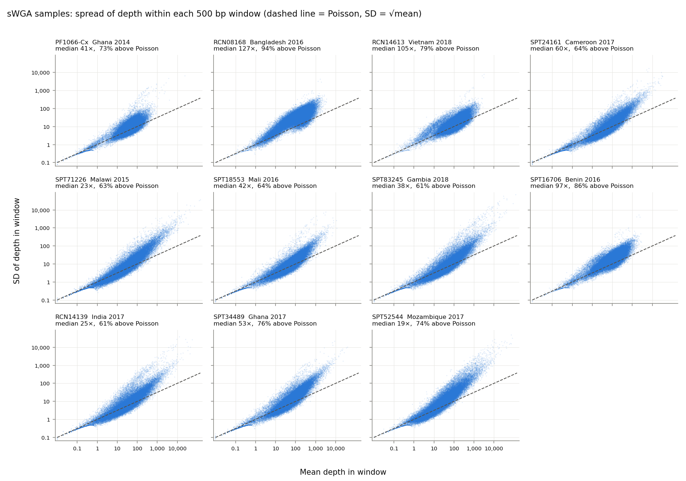

Real sequencing reads are spread very unevenly along the genome. `krsim vcf-host-depth`, which makes the host VCF (stage 4), gives each host realistic read depth, so the host VCF has the gaps, spikes and low-depth sites of real data. It has two ways to get the depth:

| Option | Depth comes from | You need |
|---|---|---|
| [**1. Depth files**](#option-1-depth-files) (`--depth_zip`) | real samples: your own, or example *P. falciparum* samples from [MalariaGEN Pf8](https://doi.org/10.12688/wellcomeopenres.24031.1) | a zip of depth files (or an example zip) |
| [**2. Depth model**](#option-2-depth-model) (`--depth_model sWGA` or `gDNA`) | a model of depth along the genome, fitted to Pf8 | nothing: just pick the sample type |

Both read the same strain VCF and write the same files, so you can make a host VCF with each from one simulation (in different `--output_dir` folders). If you have no depth data, start with option 2.

## Why depth matters

In a real sample, the number of reads covering each base varies hugely along the genome. Base composition (*P. falciparum* is about 80% AT), amplification, and stretches of the genome that are hard to map all push depth up or down. This is one real selective whole-genome amplification (sWGA) sample, its depth averaged in 500 bp windows along all 14 chromosomes:

{fig-alt="Fourteen panels, one per chromosome, showing mean read depth per 500 bp window on a log scale; depth fluctuates between about 10 and 100, drops to near 0 at chromosome ends and in some internal gaps, and spikes above 1,000 in places."}

This matters for what a host VCF can show. Where depth is high, every strain in a mixed infection is seen; where it is low, a minority strain can get no reads at all, and the site looks as if only one strain were there.

Within each window, depth also varies more than pure chance (a Poisson distribution) would give. This holds across real samples: in 11 sWGA samples from 11 countries, 61–94% of windows vary more than a Poisson, and samples differ about 7-fold in their typical depth (19× to 127×):

{fig-alt="Eleven scatter panels of window SD against window mean on log-log axes, one per sample; in every panel most points lie above the dashed Poisson line, increasingly so at higher depth."}

## Option 1: depth files {#option-1-depth-files}

krsim reads depth from **one zip file** that holds one small depth file per sample: `<sample>.window_stats.tsv`, the mean and SD of that sample's read depth in every 500 bp window of the genome. Each file is under 1 MB zipped, so a zip of 100 samples is about 50 MB.

::: {.callout-important}
## Use the 3D7 reference used by Pf8

krsim simulates the *P. falciparum* 3D7 reference genome used by MalariaGEN Pf8 (PlasmoDB-54, chromosomes `Pf3D7_01_v3` … `Pf3D7_14_v3`). By default, your reads must be mapped to this reference, so that the depth files line up with the simulated sites. krsim checks the chromosome names and lengths in every file and stops with a message if they don't match.
:::

### Your own samples

1. Run [mosdepth](https://github.com/brentp/mosdepth) on each sample's aligned reads (BAM or CRAM, mapped to the 3D7 reference above). It writes `<sample>.per-base.bed.gz`, the depth at every base:

   ```bash
   conda install -c bioconda mosdepth
   mosdepth --fasta PlasmoDB-54-Pfalciparum3D7-Genome.fasta sample1 sample1.cram
   ```

2. Turn the per-base files into depth files and zip them with the helper `krsim depth-zip` (a few seconds per sample):

   ```bash
   krsim depth-zip --bed sample1.per-base.bed.gz sample2.per-base.bed.gz ... --output my_depth.zip
   ```

   The per-base files are large (tens of MB per sample), so krsim only takes the small depth files. If you make the depth files another way, zip them yourself: each needs the columns `chrom`, `start`, `end`, `mean` and `sd`, one row per 500 bp window, starting at 0.

3. Make the host VCF:

   ```bash
   krsim vcf-host-depth --strain_vcf results/output_42_strain.vcf \
       --ind_node_map_csv results/sim_ind_node_map_42.csv \
       --depth_zip my_depth.zip --random_seed 42 --output_dir results/
   ```

### Example zips from Pf8

To try it without your own data, download one of two example zips from the krsim release [example-depth-data-v1](https://github.com/mrc-ide/KR_simulator/releases/tag/example-depth-data-v1):

| Zip | Samples |
|---|---|
| `pf8_sWGA_100.zip` | 100 sWGA samples that passed Pf8 QC, picked at random |
| `pf8_gDNA_100.zip` | 100 gDNA samples that passed Pf8 QC, picked at random |

Use either zip as `--depth_zip`. Each zip also holds `samples.tsv`, listing its samples with their country, year and study; krsim only reads the depth files, so it ignores this list.

The example depth files are made from the reads of [MalariaGEN Pf8](https://doi.org/10.12688/wellcomeopenres.24031.1), whose data are released under [CC BY 4.0](https://creativecommons.org/licenses/by/4.0/). If you use them, please cite: MalariaGEN et al. (2025). Pf8: an open dataset of *Plasmodium falciparum* genome variation in 33,325 worldwide samples. *Wellcome Open Research* 10:325.

### How option 1 works

1. **Each host gets one depth file.** The zip needs at least one file per host (`Nh`). If it has more, krsim picks files at random, each used at most once. The pick is set by `--random_seed`, so the same seed always gives each host the same file. `host_depth_profiles_<seed>.csv` records which file each host got.
2. **Strain proportions**: each host's strain proportions are drawn once from a Dirichlet.
3. At every site, for every host:
   1. find the 500 bp window the site is in, and its mean and SD of depth
   2. draw the host's read depth there from a **negative binomial** with that mean and SD (it allows the extra variation real depth shows)
   3. split those reads between the host's strains, in proportion to the strains' shares (a Multinomial)
   4. count the reads carrying each allele, and write `GT:AD:DP` (`0/0`, `1/1`, `0/1` for mixed reads, `./.` for no reads)

Only the read depth comes from the real sample. Which strains each host carries, their alleles and their proportions all come from the simulation, as before.

## Option 2: depth model {#option-2-depth-model}

No depth files needed: krsim simulates each host's depth along the genome from a model fitted to the QC-pass samples of MalariaGEN Pf8. Pick the sample type:

```bash
krsim vcf-host-depth --strain_vcf results/output_42_strain.vcf \
    --ind_node_map_csv results/sim_ind_node_map_42.csv \
    --depth_model sWGA --random_seed 42 --output_dir results/
```

| `--depth_model` | Model of depth along the genome | Fitted to |
|---|---|---|
| `sWGA` | AR(8) with Student t kicks | 17,330 QC-pass Pf8 sWGA samples |
| `gDNA` | ARMA(2,2) with Student t kicks | 6,815 QC-pass Pf8 gDNA samples |

These were the best of the models we compared on held-out data, for most samples of each type. Nearby windows have similar depth (the AR / ARMA part), and the Student t kicks allow the sudden drops and spikes real depth shows.

### How option 2 works

The model describes depth **relative to a host's own typical depth**, e.g. "this window is 3× the usual" or "a tenth of it". So the read depth at a site comes from three parts:

1. **The typical depth sets the level**: the host's median window depth, e.g. 30×.
2. **The AR or ARMA model sets the variation along the genome**: how far each 500 bp window is above or below typical, e.g. 1.43×. Each window follows the windows just before it, plus a random **kick**: most kicks are small, but the Student t allows occasional big ones, which give sudden dips and spikes. The window's expected depth is the typical depth × this value: 30 × 1.43 = 43.0.
3. **A Poisson turns that into reads**: the whole number of reads at a site in that window, e.g. 44. Sites in the same window get slightly different counts, and at low depth a site can get 0 reads.

For example, ten neighbouring windows from an sWGA host with a typical depth of 30×:

| Window | Random kick | Relative depth (model) | Expected depth (× 30) | Reads at a site (Poisson) |
|---|---|---|---|---|
| 1 | +0.20 | 0.85× | 25.6 | 23 |
| 2 | +0.29 | 1.19× | 35.7 | 42 |
| 3 | +0.16 | 1.43× | 43.0 | 44 |
| 4 | +0.02 | 1.42× | 42.6 | 48 |
| 5 | −0.05 | 1.27× | 38.2 | 35 |
| 6 | −0.29 | 0.90× | 26.9 | 24 |
| 7 | +0.26 | 1.11× | 33.3 | 26 |
| 8 | −0.65 | 0.61× | 18.2 | 14 |
| 9 | +0.34 | 0.77× | 23.0 | 27 |
| 10 | +0.19 | 1.08× | 32.5 | 33 |

Window 4 stays high after window 3 even though its own kick is small (nearby windows are alike), and window 8's big negative kick gives a sudden dip that carries into window 9.

In full, for each host:

1. **Typical depth, once per host**: drawn from a log-normal fitted to the typical depths of Pf8 samples, so some hosts are sequenced more deeply than others, as in real data (by default centred on 63× for sWGA and 77× for gDNA).
2. **Depth along the genome, once per host**: the host's own random track of relative depth from the model, one value per 500 bp window. Every host's track is different, so dips and spikes fall in different places; what hosts share is the model, i.e. how patchy depth is.
3. **Two limits from real data**: no window above a cap (37,623× the typical depth for sWGA, 610× for gDNA: the highest window, relative to its median, of any QC-pass Pf8 sample, so the simulation can reach the most extreme spike seen in real data), and, for sWGA only, low depth near chromosome ends (the last 30 kb of each end gets 0.004× the depth), since sWGA barely amplifies the subtelomeres.
4. **Strain proportions**: as in option 1, once per host from a Dirichlet.
5. At every site, for every host: the read depth is drawn from a Poisson around the window's depth, split between the host's strains with a Multinomial, and written as `GT:AD:DP`.

`host_depth_profiles_<seed>.csv` records each host's typical depth, and the VCF header lists every model value used.

### Changing the model

The defaults are the median values over all QC-pass Pf8 samples of each type; `krsim vcf-host-depth --help` lists them all. To change them:

- `--depth_mean 30`: centre the hosts' typical depths on 30× instead
- `--depth_spread 0`: give every host the same typical depth (`--depth_mean`). Depth still varies along each host's genome
- `--depth_params my_params.json`: change any other value. List only what you want to change, e.g.

  ```json
  {"nu": 3.0, "cap": 1000}
  ```

  The settings are `ar` and `ma` (lists of model coefficients), `mu`, `scale` and `nu` (the t kicks: centre, size and tail weight; a smaller `nu` gives more big jumps), `offset`, `cap`, `end_width` (bp) and `end_factor`, and `depth_mean` and `depth_spread`.

::: {.callout-note}
## Flat depth, for testing
To test a method without the effect of uneven depth, make depth flat: `--depth_spread 0` and a `--depth_params` file with

```json
{"scale": 0, "end_width": 0}
```

`scale` 0 removes the kicks, so every window gets exactly `--depth_mean`, and `end_width` 0 removes the low-depth sWGA chromosome ends. Each site's read count is still a Poisson draw, so a site can occasionally get 0 reads. This isn't realistic: use it only as a control.
:::

### What the model leaves out

The model is a realistic starting point, not a copy of real data. If you need these details, use option 1 with real depth files:

- In real data, the same regions tend to be low in every sample; here each host's dips fall in different places.
- All hosts share one level of patchiness; only their typical depth differs.
- Read depth within a window varies only by chance (Poisson); real depth varies a little more.

See the [command reference](commands.qmd) for the full details of both options.
