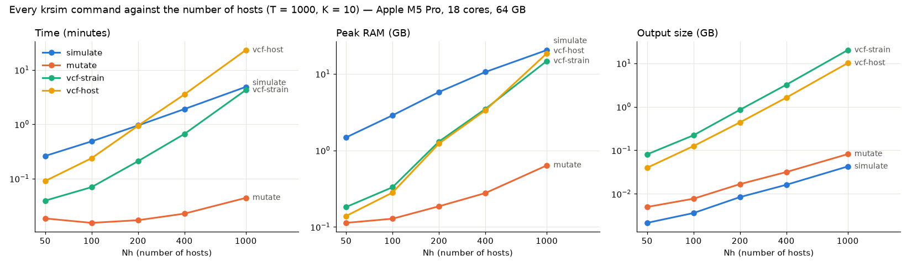
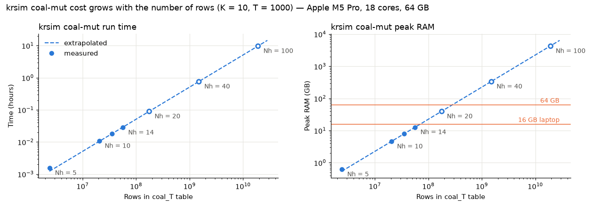

What each `krsim` command costs in time, memory (RAM) and disk space as runs get bigger, which commands become impractical, and what to request when running many simulations on a laptop or a computing cluster.

**About the numbers.** Memory and disk use are properties of the run, so they apply on any computer. Times were measured on a fast laptop (Apple M5 Pro, 18 cores, 64 GB); expect them to be about 1.5–2× longer on a typical laptop or a cluster core. Every command uses **one core**.

## Overview: the cost of each command

At the baseline of the [realistic example](tutorial-realistic.qmd) (`--Nh 100 --T 1000 --K 10 --chi 0.2 --C 3`, 1,150 strains):

| Command | Time | Peak RAM | Output | At this size |
|---|---:|---:|---:|---|
| `simulate` | 29 s | 2.9 GB | 4 MB | ✅ fine |
| `mutate` | 1 s | 0.1 GB | 8 MB | ✅ fine |
| `vcf-strain` | 4 s | 0.3 GB | 227 MB | ✅ fine, but grows quickly, see [below](#pipeline-scaling) |
| `vcf-host` | 14 s | 0.3 GB | 128 MB | ✅ fine, but grows quickly, see [below](#pipeline-scaling) |
| `coal-mut` | ~10 hours | ~4 TB | ~1 TB | ❌ not feasible, see [below](#coal-mut) |
| `relate-strain`, `relate-host` | | | | ❌ need `coal-mut`'s table |
| `pairwise-strain-pedigree-map`, `strain-transmission-map` | | | | ⚠️ for small runs, which they draw strain by strain |

The `coal-mut` figures are extrapolated (see below); the others were measured.

## How each command scales {#pipeline-scaling}

Each command was run on its own for increasing numbers of hosts (T = 1000, K = 10). Both axes are logarithmic:

{fig-alt="Time, peak RAM and output size of simulate, mutate, vcf-strain and vcf-host against the number of hosts, from 50 to 1000"}

| Nh | `simulate` | `mutate` | `vcf-strain` | `vcf-host` | **Total time** | **Largest peak RAM** | **Disk** |
|---:|---:|---:|---:|---:|---:|---:|---:|
| 50 | 16 s · 1.5 GB | 1 s · 0.1 GB | 2 s · 0.2 GB | 5 s · 0.1 GB | **25 s** | **1.5 GB** | **0.1 GB** |
| 100 | 29 s · 2.9 GB | 1 s · 0.1 GB | 4 s · 0.3 GB | 14 s · 0.3 GB | **48 s** | **2.9 GB** | **0.4 GB** |
| 200 | 57 s · 5.8 GB | 1 s · 0.2 GB | 13 s · 1.3 GB | 56 s · 1.2 GB | **2 min** | **5.8 GB** | **1.3 GB** |
| 400 | 1.9 min · 10.6 GB | 1 s · 0.3 GB | 40 s · 3.5 GB | 3.5 min · 3.3 GB | **6 min** | **10.6 GB** | **4.9 GB** |
| 1000 | 4.9 min · 20.4 GB | 3 s · 0.6 GB | 4.3 min · 14.7 GB | 23 min · 18.5 GB | **32 min** | **20.4 GB** | **30 GB** |

Each cell is time · peak RAM. Disk is the total size of all outputs.

- **`simulate`** grows in proportion to **Nh × T × K**: doubling the number of hosts, generations or parasites per bite roughly doubles its time and memory.
- **`vcf-strain` and `vcf-host`** grow faster, roughly with **Nh²**. A VCF has one column per strain and one row per variant site, and both grow with the population. By Nh = 1000, `vcf-host` is the slowest command (23 minutes), its memory is close to `simulate`'s, and the two VCFs take 30 GB of disk. The number of generations makes little difference to the VCFs (see below).
- **`mutate`** stays small throughout.

::: {.callout-note collapse="true"}
## Effect of the number of generations (T)

Nh = 100, K = 10. T mainly changes `simulate`; the number of variant sites, and so the VCFs, grows only slowly.

| T | `simulate` | `mutate` | `vcf-strain` | `vcf-host` | Total time | Disk |
|---:|---:|---:|---:|---:|---:|---:|
| 250 | 8 s · 1.0 GB | 1 s · 0.1 GB | 4 s · 0.3 GB | 13 s · 0.2 GB | 25 s | 0.3 GB |
| 500 | 15 s · 1.4 GB | 1 s · 0.1 GB | 4 s · 0.3 GB | 13 s · 0.2 GB | 33 s | 0.3 GB |
| 1000 | 29 s · 2.9 GB | 1 s · 0.1 GB | 4 s · 0.3 GB | 14 s · 0.3 GB | 48 s | 0.4 GB |
| 2000 | 57 s · 5.7 GB | 1 s · 0.1 GB | 5 s · 0.4 GB | 19 s · 0.3 GB | 1.4 min | 0.5 GB |
:::

::: {.callout-note collapse="true"}
## `simulate` with the other parameters

Varying one parameter at a time, the others at the baseline. Superinfection (`--chi`) and oocysts per mosquito (`--C`) have smaller effects than Nh, T and K, and `--C` does not change memory.

| Nh | T | K | chi | C | Time | Peak RAM | Strains | Trees |
|---:|---:|---:|---:|---:|---:|---:|---:|---:|
| 50 | 1000 | 10 | 0.2 | 3 | 14 s | 1.4 GB | 640 | 17,258 |
| **100** | **1000** | **10** | **0.2** | **3** | **28 s** | **2.8 GB** | **1,150** | **28,773** |
| 200 | 1000 | 10 | 0.2 | 3 | 57 s | 5.6 GB | 2,370 | 66,225 |
| 400 | 1000 | 10 | 0.2 | 3 | 1 min 57 s | 10.5 GB | 4,740 | 125,131 |
| 1000 | 1000 | 10 | 0.2 | 3 | 4 min 58 s | 20.2 GB | 11,910 | 328,711 |
| 100 | 250 | 10 | 0.2 | 3 | 7 s | 1.0 GB | 1,200 | 30,174 |
| 100 | 500 | 10 | 0.2 | 3 | 14 s | 1.4 GB | 1,180 | 28,241 |
| 100 | 2000 | 10 | 0.2 | 3 | 56 s | 5.7 GB | 1,200 | 31,041 |
| 100 | 1000 | 5 | 0.2 | 3 | 19 s | 1.4 GB | 575 | 20,177 |
| 100 | 1000 | 20 | 0.2 | 3 | 46 s | 5.7 GB | 2,300 | 39,625 |
| 100 | 1000 | 10 | 0.05 | 3 | 25 s | 2.5 GB | 1,050 | 22,210 |
| 100 | 1000 | 10 | 0.5 | 3 | 35 s | 3.4 GB | 1,470 | 55,218 |
| 100 | 1000 | 10 | 0.2 | 1 | 22 s | 2.8 GB | 1,160 | 12,598 |
| 100 | 1000 | 10 | 0.2 | 5 | 33 s | 2.7 GB | 1,230 | 41,387 |

The baseline is in bold. Strains are the parasites sampled in the current generation; trees are the number of distinct genealogies along the genome.
:::

## What to request

The commands for one simulation run one after another, each using the previous one's output, so run them together as **one job per simulation**:

- **Cores:** 1.
- **Memory:** the largest peak of any command, plus a margin. The commands' peaks are similar at large sizes, so one request suits them all.
- **Time:** all the commands added together.
- **Disk:** all the outputs together.

For the whole pipeline (`simulate` → `mutate` → `vcf-strain` → `vcf-host`), T = 1000, K = 10. The requests allow 1.5× the peak RAM and plenty of time for slower cores:

| Nh | Total time (fast laptop) | Largest peak RAM | Request: memory | Request: time | Disk per simulation |
|---:|---:|---:|---:|---:|---:|
| 50 | 25 s | 1.5 GB | 4 GB | 15 min | 0.1 GB |
| 100 | 48 s | 2.9 GB | 8 GB | 15 min | 0.4 GB |
| 200 | 2 min | 5.8 GB | 16 GB | 15 min | 1.3 GB |
| 400 | 6 min | 10.6 GB | 16 GB | 30 min | 4.9 GB |
| 1000 | 32 min | 20.4 GB | 32 GB | 2 hours | 30 GB |

- **Leave out what you don't need.** Without the VCFs, a run needs only the `simulate` time and memory, and a few MB of disk. If you only need one VCF, skip the other.
- **Disk adds up across runs.** 10 seeds at Nh = 1000 need about 300 GB.
- **Other T or K.** `simulate`'s time and memory scale with T × K. The VCFs depend mainly on the number of strains, which grows with Nh × K.
- If a job needs more memory or time than it requested, the cluster stops it partway through.

## `coal-mut`: for practice runs, not realistic ones {#coal-mut}

`krsim coal-mut` writes one row for **every pair of strains in every tree** along the genome. It is useful for learning on small runs like the [small example](tutorial-small.qmd), where you can read the table directly. But both factors grow with the run: the number of strain pairs grows with the square of the number of strains, and the number of trees grows with the population too. In total, the number of rows grows roughly with **Nh³**.

Its run time, memory and file size are almost exactly proportional to the number of rows: about 1.8 µs, 240 bytes of RAM and 52 bytes of CSV per row. That makes it possible to extrapolate from small runs (filled points) to sizes it cannot finish (open points):

{fig-alt="Run time and peak RAM of krsim coal-mut against the number of rows, measured for Nh 5 to 14 and extrapolated to Nh 100"}

| Nh (T = 1000, K = 10) | Rows | Time | Peak RAM | CSV size | |
|---:|---:|---:|---:|---:|---|
| 5 | 2.4 million | 6 s | 0.6 GB | 0.1 GB | measured |
| 10 | 21 million | 39 s | 4.6 GB | 1.1 GB | measured |
| 14 | 56 million | 1.7 min | 13 GB | 2.9 GB | measured |
| 20 | 176 million | ~5 min | ~40 GB | ~9 GB | extrapolated |
| 40 | 1.5 billion | ~45 min | ~340 GB | ~75 GB | extrapolated |
| **100 (baseline)** | **19 billion** | **~10 hours** | **~4 TB** | **~1 TB** | extrapolated |

So `coal-mut` runs out of memory at about **Nh ≈ 15 on a 16 GB laptop** and **Nh ≈ 25 with 64 GB** (T = 1000, K = 10).

**Check before you run it.** Count the rows from the tree sequence first; this takes seconds:

```bash
python benchmarks/scaling.py coal-rows ts_mut_42.trees
```

**What to use instead.** Coalescence time distributions (all pairs, same-host and different-host pairs, along the genome) can be computed directly from the tree sequence with tskit's [`pair_coalescence_counts`](https://tskit.dev/tskit/docs/stable/python-api.html#tskit.TreeSequence.pair_coalescence_counts) and [`pair_coalescence_quantiles`](https://tskit.dev/tskit/docs/stable/python-api.html#tskit.TreeSequence.pair_coalescence_quantiles), as in the [realistic example](tutorial-realistic.qmd). These return the summaries without writing one row per pair, and take under a second even at Nh = 1000.

## Running many simulations

Replicate seeds and parameter sweeps are independent runs, so they can go side by side. One run uses **one core**: giving a run more cores does not make it faster, but more cores let more runs go at once.

8 baseline simulations (`simulate` only), run 1, 2, 4 and 8 at a time:

| Runs at once | Total time for 8 runs | Time per run | Speed-up | RAM needed together |
|---:|---:|---:|---:|---:|
| 1 | 4 min | 29 s | 1× | ~3 GB |
| 2 | 2 min | 29 s | 2× | ~6 GB |
| 4 | 1 min | 30 s | 3.9× | ~11 GB |
| 8 | 44 s | 43 s | 5.4× | ~22 GB |

Up to 4 at once, each run takes as long as it does alone. At 8, the runs start competing for the processor's fastest cores and for memory, so each one slows down.

**On a typical laptop (4–8 cores, 8–16 GB), memory is the limit, not cores.** Every run needs its own peak RAM, so the number you can run at once is the smaller of:

- the number of cores, leaving one or two for everything else, and
- the free RAM ÷ peak RAM per run.

| Laptop RAM | Nh = 100 runs at once (3 GB each) | Nh = 400 runs at once (11 GB each) |
|---|---:|---:|
| 8 GB | 2 | 0, use a cluster |
| 16 GB | 4 | 1 |
| 32 GB | 8 | 2 |

**On a cluster**, use an array job, described below.

## SLURM array job

An **array job** is one submission that runs many tasks: here, one simulation per task, running the whole pipeline. Each task asks for one core and its own memory, and the scheduler runs as many at once as the cluster has room for.

[`slurm/krsim_array.sh`](https://github.com/mrc-ide/KR_simulator/blob/main/slurm/krsim_array.sh) does this. Each task reads one line of [`slurm/params.tsv`](https://github.com/mrc-ide/KR_simulator/blob/main/slurm/params.tsv) and runs `simulate`, `mutate`, `vcf-strain` and `vcf-host`, writing everything to its own folder, `results/Nh<Nh>_T<T>_K<K>_chi<chi>_C<C>/`. To run only some of the commands, edit `STEPS` at the top of the script.

The example `params.tsv` has 5 baseline seeds and 3 seeds each at low and high superinfection; each line is one simulation:

```
Nh   T     K   chi   C  seed
100  1000  10  0.2   3  1
...
100  1000  10  0.05  3  1
...
100  1000  10  0.5   3  1
...
```

Copy the `slurm/` folder to the cluster and submit it from there, with one task per line of `params.tsv`:

```bash
cd slurm
mkdir -p logs
sbatch --array=1-$(($(wc -l < params.tsv) - 1)) krsim_array.sh
```

Every task gets the same memory and time request (8 GB and 30 minutes in the script), so set them for the largest run in the file, using [What to request](#what-to-request). Alternatively, put large runs in a separate file with their own request:

```bash
sbatch --mem=32G --time=02:00:00 --array=1-5 krsim_array.sh params_large.tsv
```

When the jobs have finished, copy `results/` back and analyse the tree sequences in Jupyter. The analysis in the [realistic example](tutorial-realistic.qmd) takes under a second per run.

::: {.callout-note collapse="true"}
## The full script

```bash

```
:::

## Re-measuring on your machine

The measurements are in [`benchmarks/`](https://github.com/mrc-ide/KR_simulator/tree/main/benchmarks): `pipeline.csv` (every command), `benchmarks.csv` (`simulate` across parameters) and `coal_mut.csv`. [`benchmarks/scaling.py`](https://github.com/mrc-ide/KR_simulator/blob/main/benchmarks/scaling.py) measures one parameter set per call. Run one at a time so the timings don't compete:

```bash
python benchmarks/scaling.py pipeline --Nh 200   # every command; other parameters at the baseline
python benchmarks/scaling.py plot                # redraws the figures on this page
```
